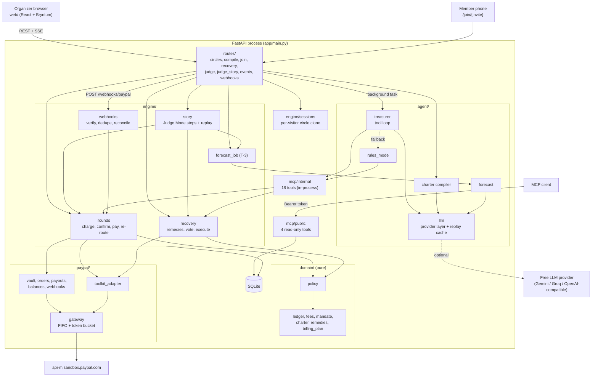

# Architecture

One FastAPI process (one uvicorn worker), SQLite, and the PayPal sandbox. The rule throughout: **the model
proposes, deterministic code decides, humans approve where it matters.** Every money action passes the policy
engine, whatever proposed it (model, rules mode, or a Judge Mode button).

## Diagram (ASCII)

```
 Organizer browser (React + Bryntum board)      Member phone (/join/{invite})       MCP client (Claude Desktop, ...)
          │  REST + SSE                                │                                   │ Bearer MCP_DEMO_TOKEN
          ▼                                            ▼                                   ▼
 ┌──────────────────────────────────────── FastAPI  app/main.py ─────────────────────────────────────────────────┐
 │ routes/  circles · compile · join · recovery · judge · judge_story · events (SSE) · webhooks     /mcp (public) │
 │                                                                                                                │
 │ engine/sessions ── cookie tk_sid → per-visitor clone of the fixture circle, new run_id per Reset, cap 6        │
 │                                                                                                                │
 │ ┌─ engine/ ────────────────────┐   ┌─ agent/ ────────────────────────────┐   ┌─ mcp/ ────────────────────────┐ │
 │ │ rounds     charge, confirm,  │   │ treasurer   tool loop (≤ 25 calls)  │──►│ internal  18 tools, in-process│ │
 │ │            pay, re-route     │◄──│ rules_mode  same sequence, no model │◄──│           (never mounted)     │ │
 │ │ recovery   remedies, vote,   │   │ charter     rules text → Charter    │   │ public    4 read-only tools,  │ │
 │ │            execute, invoice  │   │ forecast    risk score + nudge      │   │           demo circles, PII   │ │
 │ │ forecast_job (T-3)           │   │ llm         provider layer + replay │   │           masked              │ │
 │ │ webhooks   verify, dedupe,   │   │             cache (llm_cache table) │   └───────────────────────────────┘ │
 │ │            reconcile         │   └──────────────┬──────────────────────┘                                     │
 │ │ story      Judge Mode steps  │                  │ one optional call per feature                             │
 │ │ clock · inbox · join · state │                  ▼                                                           │
 │ │ events (SSE bus)             │        free provider (Gemini / Groq / any OpenAI-compatible), or none         │
 │ └──────┬───────────────────────┘                                                                              │
 │        │ every money action                                                                                   │
 │        ▼                                                                                                      │
 │ ┌─ domain/ (pure, no I/O) ──────────────────────────────────────────────────┐                                 │
 │ │ policy · charter · mandate (HMAC) · ledger · fees · remedies · billing_plan │                                │
 │ └───────────────────────────────────────────────────────────────────────────┘                                 │
 │        │                                                                                                      │
 │        ▼                                                                                                      │
 │ ┌─ paypal/ ─────────────────────────────────────────────────────────────────────────────────────┐             │
 │ │ gateway: FIFO worker + token bucket 40/min ── client: OAuth cache, retries, PayPal-Request-Id │             │
 │ │ vault · orders · payouts · balances · webhooks (REST)      toolkit_adapter (Agent Toolkit)    │             │
 │ └───────────────────────────────────────────────┬───────────────────────────────────────────────┘             │
 │ SQLite (db.py, models.py): circles, members, rounds, contributions, ledger, mandates, remedy sets, votes,     │
 │ inbox, forecasts, payout_attempts, agent traces, webhook events, paypal_calls, llm_cache, judge stories       │
 └──────────────────────────────────────────────────┼────────────────────────────────────────────────────────────┘
                                                    ▼
                         api-m.sandbox.paypal.com  (OAuth, Vault v3, Orders v2, Payouts v1, Reporting/Balances,
                                                    Invoicing via the Agent Toolkit, Webhooks)
```

## Diagram (Mermaid)



## Modules

| Area | Files | Responsibility |
|---|---|---|
| App and routes | `app/main.py`, `app/routes/*.py` | REST API, SSE stream, join redirects, webhook intake, `/healthz`, the built SPA, the public MCP mount |
| Sessions | `app/engine/sessions.py` | Cookie `tk_sid`; each visitor gets a clone of the demo circle with its own `run_id`; 6 active sessions, 20-min idle TTL, then HTTP 429 with a `replay_url` |
| Round engine | `app/engine/rounds.py` | Merchant-initiated charges, toolkit capture confirmation, ledger + mandate + balance gates, payout, UNCLAIMED re-route |
| Recovery | `app/engine/recovery.py`, `app/engine/inbox.py`, `app/domain/remedies.py` | Decline notice, reply parsing, charter-legal remedy sets, consents, vote, organizer approval, execution (buffer advance, turn swap, invoice) |
| Forecast | `app/agent/forecast.py`, `app/engine/forecast_job.py` | Deterministic risk score at T-3; one optional model call words the reason and nudge |
| Charter compiler | `app/agent/charter.py`, `app/domain/charter.py`, `app/domain/billing_plan.py` | Free text (English or Hindi) → typed charter → canonical JSON → SHA-256 → Vault `billing_plan` |
| Join | `app/engine/join.py`, `app/routes/join.py` | Signed invites, Vault setup token → PayPal approval → payment token |
| Agent | `app/agent/treasurer.py`, `app/agent/rules_mode.py`, `app/agent/llm.py` | Tool loop over the internal MCP server with per-task tool allowlists; rules mode runs the same tools with no model |
| MCP | `app/mcp/internal.py`, `app/mcp/public.py`, `app/mcp/auth.py` | 18 internal tools (money tools policy-gated); 4 public read-only tools on demo circles, PII masked, 30 req/min |
| Policy and money | `app/domain/policy.py`, `ledger.py`, `fees.py`, `mandate.py` | Deterministic allow/deny; per-circle net ledger; fee estimates; HMAC-signed payout mandate |
| PayPal | `app/paypal/*.py` | See [api-table.md](api-table.md) |
| Webhooks | `app/engine/webhooks.py` | Signature verification, event-id dedupe, reconciliation, mandate-triggered payout |
| Judge Mode | `app/engine/story.py`, `app/routes/judge_story.py`, `app/routes/judge.py` | Scripted story steps, simulated labels when the sandbox is not live, canonical replay recording |
| Web | `web/src/` | Bryntum rotation board (CSS-grid fallback), agent trace, phone inbox, recovery panel, Judge bar |

## Gates on a payout (`rounds.pay_round`)

1. Policy: the recipient is the round's (or the approved swap's) member, every contribution is COMPLETED or
   COVERED, one live payout per round, amount ≤ the gross cap.
2. Mandate: an HMAC-signed organizer mandate over the charter hash, recipient order and cap verifies
   (`domain/mandate.py`), or the organizer approves the payout.
3. Ledger: the circle's own net ledger covers the pot (`domain/ledger.circle_available`). This is the binding check.
4. Balances: a **fresh** PayPal balance (≤ 15 min old) below the pot refuses; a stale one is shown but never blocks
   (D1 finding: the sandbox balance lagged ~2.5 h).
5. Simulated rounds (`REPLAY-SIM-` ids) are refused, so a simulated round never moves real sandbox money.
